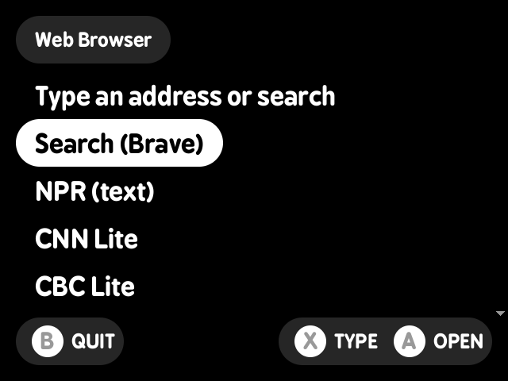
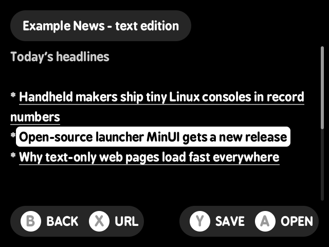
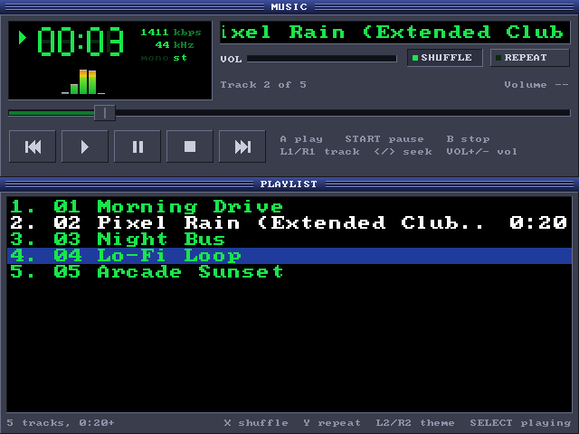
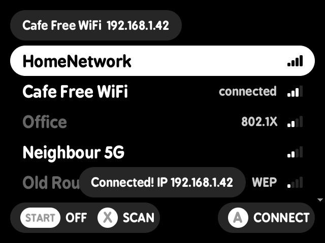
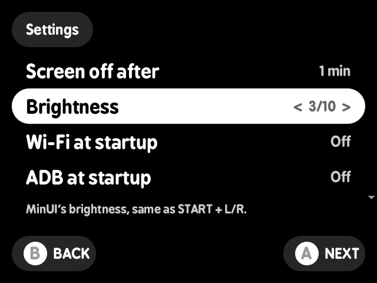
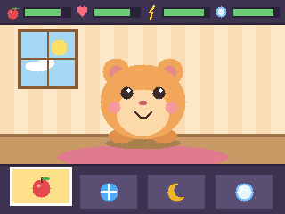

# pocketkit

Small Rust apps for retro handhelds, with a look borrowed from MinUI: a text web browser
and downloader, a music player, a Wi-Fi picker, a settings app and a virtual pet.

<p>






</p>

## Apps and devices

| App | Miyoo Mini+ (MinUI) | RG35XX-SP (muOS) |
|---|:---:|:---:|
| [Web Browser](apps/web-browser) — text pages, links, HTTPS, downloads | ✓ | ✓ |
| [Music](apps/music) — MP3/FLAC/OGG/WAV/M4A, playlist, spectrum analyzer | ✓ | ✓ |
| [Wifi](apps/wifi) — pick a network, type the password | ✓ | (muOS has its own) |
| [Settings](apps/settings) — screen-off time, brightness, Wi-Fi/ADB at startup | ✓ | (muOS has its own) |
| [Pocket Pet](apps/pocket-pet) — a tiny virtual pet | ✓ | |

Tested on a Miyoo Mini+ running MinUI and an Anbernic RG35XX-SP running muOS. Other
devices on these systems may work but haven't been tried.

## Install

Download the files from the [latest release](../../releases/latest).

**MinUI (Miyoo Mini+)**: unzip `<App>.pak.zip` and copy the `<App>.pak` folder into
`Tools/miyoomini/` on the SD card. Wifi needs the Wi-Fi driver from MinUI's ADBD.pak
(MinUI Extras). Logs go to `.userdata/miyoomini/<app>/log.txt`.

**muOS (RG35XX-SP)**: copy `<App>.muxapp` into the `ARCHIVE/` folder on the SD card, then
install it from **Applications → Archive Manager**. Logs go to
`/root/.config/pocketkit/<app>/log.txt`.

Common controls: A selects, B goes back (or quits from the first screen), MENU quits.
Our apps turn the screen off after the idle time set in Settings (1 minute by default)
or when you press POWER; any button wakes it.

## Build

Everything builds from one Nix flake (Linux x86_64; it provides the Rust targets, the
linkers, and for MinUI's Music the Miyoo Mini toolchain):

```sh
direnv allow                # or: nix develop
./package.sh                # every app -> dist/minui/<App>.pak, dist/muos/<App>.muxapp
./package.sh muos music     # one app for one platform
cargo run --release -p web_browser   # try an app in a desktop window
cargo test --workspace
```

`./deploy.sh` copies apps straight to a device over Wi-Fi: MinUI over adb
(`./deploy.sh --ip <ip> music`), muOS over SSH (`./deploy.sh --muos --ip <ip> music`).
See `./deploy.sh --help`.

The workspace is `crates/core` (drawing, UI, settings, main loop), `crates/platform`
(screen and buttons for the desktop preview, MinUI and muOS) and one crate per app in
`apps/`. [CLAUDE.md](CLAUDE.md) has the details, including the hardware facts each
platform relies on.

## Credits

- The UI follows [MinUI](https://github.com/shauninman/MinUI)'s design. On MinUI, the
  apps use MinUI's own font from the SD card; it isn't included here.
- [muOS](https://muos.dev) (MustardOS) for the RG35XX-SP support it makes possible.
- MinUI's Music build uses the
  [Miyoo Mini toolchain](https://github.com/shauninman/miyoomini-toolchain-buildroot).
- Built on [Symphonia](https://github.com/pdeljanov/Symphonia),
  [rustls](https://github.com/rustls/rustls), [ureq](https://github.com/algesten/ureq),
  [fontdue](https://github.com/mooman219/fontdue) and
  [minifb](https://github.com/emoon/rust_minifb).

## License

The code is under the [MIT License](LICENSE).

muOS builds bundle [Atkinson Hyperlegible](packaging/muos/font) (Braille Institute of
America), which is under the SIL Open Font License 1.1, not MIT. Its license file ships
with every muOS app.

pocketkit isn't affiliated with MinUI, muOS, Miyoo or Anbernic. Their names are used only
to say which systems the apps run on.
