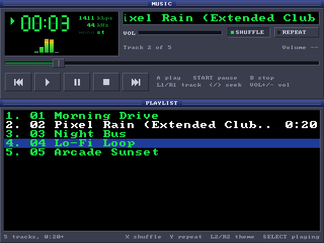

# Music

A music player in the style of the classic late-90s desktop players: LED time display,
scrolling title, spectrum analyzer, volume slider, transport buttons and a playlist
window. All artwork is original and drawn in code (`src/skin.rs`).

Plays MP3, FLAC, OGG Vorbis, WAV and AAC/M4A (decoded in pure Rust by Symphonia),
subfolders included, in path order. Runs on **MinUI** (Miyoo Mini+) and **muOS**
(RG35XX-SP).



| Platform | Music folder | Install |
|---|---|---|
| MinUI | `Music/` at the root of the SD card (or the folder chosen in Settings) | copy `Music.pak` into `Tools/miyoomini/` |
| muOS | muOS's music folder (`MUOS/music` on the SD card) | put `Music.muxapp` in `ARCHIVE/` and install it from Applications → Archive Manager |

## Controls

| Button | Desktop preview | Action |
|---|---|---|
| Up / Down | arrows | move in the playlist |
| A | Z or Space | play the selected track |
| START | Enter | pause / resume (or play) |
| B | X | stop |
| L1 / R1 | Q / W | previous / next track (L1 restarts the track after 3 s) |
| Left / Right | arrows | seek -5 s / +5 s (hold to keep seeking) |
| X | C | shuffle on / off |
| Y | V | repeat: off / all / one |
| SELECT | Tab | jump to the playing track |
| MENU | Esc | quit (shuffle, repeat and the last track are remembered) |

Volume is the system volume (the device's VOL+/- buttons); the slider follows it (MinUI's
shared settings on the Mini, PipeWire on muOS). The screen turns off after the idle time
set in Settings (or with POWER) and the music keeps playing.

## Develop

From the repo root, in the Nix dev shell:

```sh
MUSIC_DIR=~/Music cargo run --release -p music   # preview window; audio via pw-play, paplay or aplay
cargo test -p music                              # decoder, resampler, FFT, play order, player thread, screen
cargo run -p music --example music_snapshot      # snapshots/*.ppm (generated test tones, no audio)
./package.sh minui music                         # -> dist/minui/Music.pak
./package.sh muos music                          # -> dist/muos/Music.muxapp
```

The folder is `MUSIC_DIR` if set, else the `music_dir` setting, else `Music/` on the SD
card (`~/Music` or `./music` on a desktop); state goes to `MUSIC_STATE` (default
`./state.txt`).

## Audio per platform

- **MinUI (Miyoo Mini+)**: the firmware's audio server owns the hardware, and MinUI
  preloads `libpadsp.so`, which turns `/dev/dsp` into a pipe to it. `src/ao_shim.c` writes
  there (with workarounds for two crashes in that library), falling back to the vendor
  `MI_AO` API when no server runs. Both need glibc, so this one build targets
  `armv7-unknown-linux-gnueabihf` with the Miyoo Mini toolchain MinUI itself uses (the
  Nix dev shell downloads it; x86_64 Linux only). The vendor libraries are linked
  statically; only the device's glibc is needed at runtime.
- **muOS and desktop**: raw PCM is piped to `pw-play`, `paplay` or `aplay`, whichever
  works (muOS's `pw-play` is too old for raw input, and its ALSA default goes through
  PipeWire, so `aplay` follows the system volume).

Logs: `.userdata/miyoomini/music/log.txt` (MinUI), `/root/.config/pocketkit/music/log.txt` (muOS).
