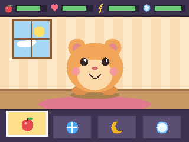

# Pocket Pet

A tiny virtual pet for the Miyoo Mini+ (**MinUI**), written in Rust.
Feed, play with, wash and put your pet to bed. Its needs keep ticking while the
console is off (up to 8 hours' worth).

Everything is drawn in code (`src/render.rs`); there are no art assets.



## Controls

| Mini+ | Desktop preview | Action |
|---|---|---|
| Left / Right (or L1 / R1) | Left / Right (or A / S) | Choose Feed, Play, Sleep, Clean |
| A | Z or Space | Do it (a head-shake means "not now") |
| MENU | Esc | Save and quit |

## Develop

From the repo root, in the Nix dev shell:

```sh
cargo run --release -p pocket_pet               # preview window
cargo test -p pocket_pet                        # game logic, save format, renderer smoke tests
cargo run -p pocket_pet --example pet_snapshot  # snapshots/*.ppm, one per mood
PET_SPEED=60 cargo run -p pocket_pet            # needs run 60x faster, handy for testing moods
./package.sh minui pocket-pet                   # -> dist/minui/Pocket Pet.pak
```

Saves go to `pet_save.txt` (override with `PET_SAVE_PATH`). Copy `Pocket Pet.pak` into
`Tools/miyoomini/` on the SD card; errors go to `.userdata/miyoomini/pocket-pet/log.txt`.

## Status

Runs on a Miyoo Mini+. It still has its own 320x240 renderer and Miyoo backend
(`src/platform/`, built with `--features device`) rather than the shared pocketkit
crates, so it isn't on muOS yet.

## Layout

- `src/game.rs`: pet stats, actions, moods, save format (pure, tested)
- `src/render.rs`: software renderer (320x240, scaled 2x on device)
- `src/app.rs`: input handling, autosave, offline catch-up
- `src/platform/`: `desktop.rs` (preview window) and `device.rs` (Mini+)
