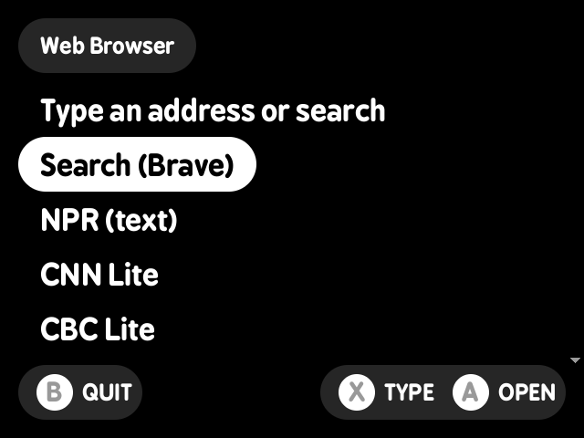
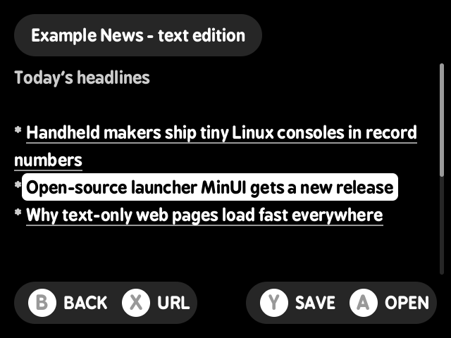

# Web Browser

A tiny text-mode web browser and downloader. It shows a page's text and links (no
images, CSS or JavaScript) and saves files from links to the SD card. HTTPS works
(rustls with bundled Mozilla root certificates). Runs on **MinUI** (Miyoo Mini+) and
**muOS** (RG35XX-SP); needs Wi-Fi to be on (the Wifi app on MinUI, muOS's own network
settings on muOS).

 

| Platform | Downloads go to | Install |
|---|---|---|
| MinUI | `Downloads/` at the root of the SD card | copy `Web Browser.pak` into `Tools/miyoomini/` |
| muOS | `Downloads/` at the root of the SD card (`/mnt/mmc/Downloads`) | put `Web Browser.muxapp` in `ARCHIVE/` and install it from Applications → Archive Manager |

## Controls

| Button | Desktop preview | Page | Home | Keyboard |
|---|---|---|---|---|
| Up / Down | arrows | previous / next link (scrolls when none is on screen) | move | move |
| Left / Right, L1 / R1 | arrows, Q / W | page up / down | page up / down | move; L1 clear, R1 `.com` |
| A | Z or Space | open link | open | type key |
| Y | V | **save link to SD card** | | space |
| B | X | back (or cancel a download) | back to page, or quit | delete |
| X | C | edit address | type address | abc / ABC / symbols |
| START | Enter | home | | go |
| SELECT | Tab | normal / small text | normal / small text | cancel |
| MENU | Esc | quit | quit | quit |

Typing something without a dot, or with spaces, searches (Brave Search by default; the
Settings app on MinUI can switch to DuckDuckGo Lite or Wiby). Opening a link that isn't a
web page (zip, pdf, ...) downloads it; Y downloads any link. Downloads are written as
`name.part` until complete and never overwrite an existing file.

Bookmarks are `bookmarks.txt` inside the app folder (`Name | URL` per line); edit it on
your computer. Redeploying keeps your edited copy.

If the device clock is wrong (e.g. reset to 1970), certificates are checked against the
build date instead, so HTTPS keeps working.

## Develop

From the repo root, in the Nix dev shell:

```sh
cargo run --release -p web_browser                               # preview window
cargo test -p web_browser                                        # parser, layout, navigation, URL/filename helpers
cargo run -p web_browser --example browser_snapshot              # snapshots/*.ppm of each screen (no network)
cargo run -p web_browser --example fetch -- https://text.npr.org # fetch + print a page as text
cargo run -p web_browser --example fetch -- --save <url>         # download into ./downloads
./package.sh minui web-browser                                   # -> dist/minui/Web Browser.pak
./package.sh muos web-browser                                    # -> dist/muos/Web Browser.muxapp
```

Env: `BROWSER_BOOKMARKS` (default `pak/minui/bookmarks.txt`), `BROWSER_DOWNLOAD_DIR`
(default `./downloads`), `BROWSER_SEARCH_URL` (the query is appended to it).

Logs: `.userdata/miyoomini/web-browser/log.txt` (MinUI), `/root/.config/pocketkit/web-browser/log.txt` (muOS).
